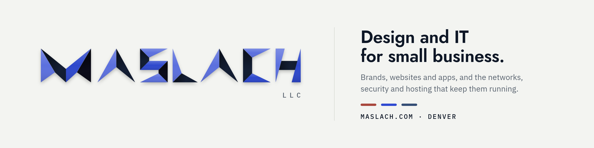

<picture>
  <source media="(prefers-color-scheme: dark)" srcset="header-dark.png">
  
</picture>

Maslach LLC is a design and IT studio in Denver. We make brands, websites and apps, and run the networks, security and hosting that keep them going.

[maslach.com](https://maslach.com) · [tonoslab.com](https://tonoslab.com)

### What we build

- **[tonos lab](https://tonoslab.com)**: the theory chart that hears you play. Live chord detection lights up the tension wheel, fretboard, piano and circle of fifths while you play a real instrument.
- **[tmux-motion](https://github.com/maslach-llc/tmux-motion)**: small transitions for tmux, in pure shell and installed with one `@plugin` line. Open source.
- **orkami**: origami for the web, a fold engine that unfolds parts of a page out of the background like real paper, with CSS and WebGL drivers and a Vue adapter. MIT, coming soon.
- **Client sites**: websites for small businesses, built on our shared Nuxt layer and UI kit.
